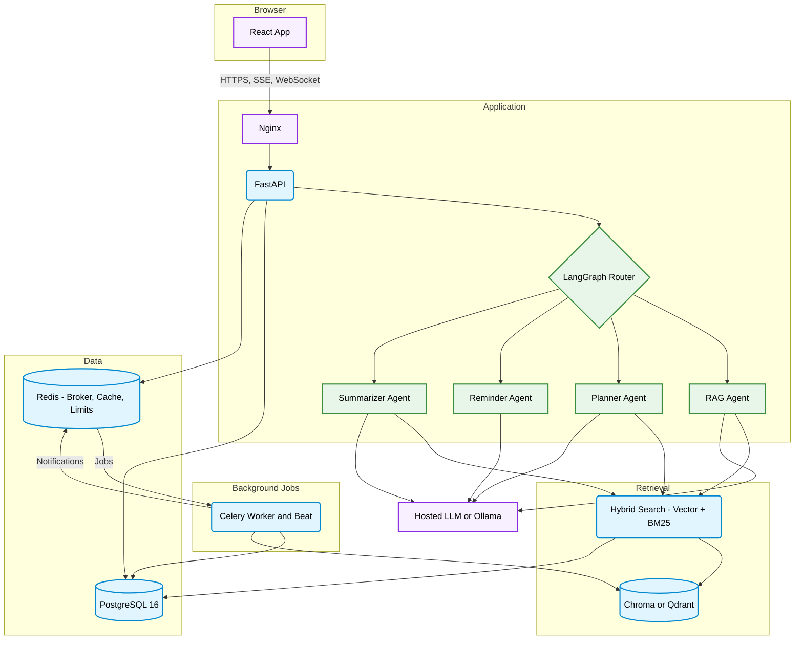

<p align="center">
  
</p>

# CampusMind

An enterprise multi-agent AI assistant and RAG platform for universities and higher-education institutions, deployed for the **University of Lucknow (UoL)** across all 7 faculties, 60+ academic departments, and central administrative bodies. Answers questions from official university ordinances, syllabi, guidelines, and circulars with verifiable citations, and orchestrates specialized LangGraph agents for study planning, reminders, and note summarization.

> **Live Deployments:**
> * **Interactive Web Platform (Vercel):** [campusmind-uol.vercel.app](https://campusmind-uol.vercel.app/)
> * **AI Backend & Inference Engine (Hugging Face ZeroGPU):** [shashank17singh-campusmind.hf.space](https://shashank17singh-campusmind.hf.space)
> * **Cloud Database (Supabase):** PostgreSQL 17 with unified relational metadata and vector embeddings
> * **Automated Synchronization:** Weekly cloud cron (GitHub Actions) syncing official university circulars, academic ordinances, and departmental rosters from [lkouniv.ac.in](https://www.lkouniv.ac.in/) and [udrc.lkouniv.ac.in](http://udrc.lkouniv.ac.in/)
>
> **Demo Accounts:**
> * **Student Role:** `student@college.edu` | `DemoPassword123!` (CSE Department, Semester 3)
> * **Faculty Role:** `faculty@college.edu` | `DemoPassword123!` (CSE Department Faculty)
> * **Admin Role:** `admin@college.edu` | `DemoPassword123!` (Institutional Administrator)

## Overview

CampusMind provides a unified, university-wide conversational intelligence layer for students, faculty, and administration across all degree programs and disciplines:
* **All 7 University Faculties:** Faculty of Arts, Science, Commerce, Law, Education, Fine Arts, and Engineering & Technology.
* **60+ Academic Departments:** Complete department directories, Head of Department contacts, faculty member rosters (professors, associate/assistant professors, emails, specializations), research labs, and course offerings.
* **All Degree Levels:** Undergraduate, Postgraduate, Professional, and Doctoral programmes (BA, B.Sc, B.Com, B.Tech, LL.B, B.Ed, BVA, MA, M.Sc, M.Com, LL.M, M.Ed, MVA, MBA, MCA, Ph.D).
* **Central Student Services & Campus Life:** Proctorial Board regulations, anti-ragging guidelines, Central Hostel allocation rules, Tagore Central Library policies, and the Central Placement & Career Counselling Cell.
* **Examinations & Statutes:** Controller of Examination guidelines, grading scales, back-paper regulations, academic ordinances, and semester schedules.

Faculty and administrators upload circulars, syllabi, and official notices, and students receive answers drawn strictly from official documents, accompanied by clickable numbered citations. If the official documents do not contain the answer, the anti-hallucination guardrail explicitly refuses rather than guessing.

A LangGraph router dynamically routes queries to specialized agents: study plan synthesis around examination timetables, plain-English reminder scheduling, and multi-format document summarization. Role-based access control guarantees strict server-side permission enforcement for students, faculty, and administrators.

> Verified with leak-free multi-agent LangGraph workflows, full document citation pipelines, and live edge web deployment. See [Known Limitations](#known-limitations) for details.

---

## Architecture Overview



- A question streams back over SSE. The router picks the agent, the RAG agent searches with the student's department and semester as filters, and citations arrive as the final event.
- An upload is stored and queued. A Celery worker extracts, cleans, chunks and embeds it, and reports progress over a WebSocket.
- Celery beat checks for due reminders every minute. An idempotency key stops the same notification being claimed twice.

---

## Features

|                        |                                                                                                                  |
| ---------------------- | ---------------------------------------------------------------------------------------------------------------- |
| **Cited Answers**      | Answers stream token by token, with numbered sources that open beside the answer                                 |
| **Hybrid Search**      | Vector and BM25 results merged with reciprocal rank fusion, plus an optional cross-encoder re-ranker             |
| **Scoped Results**     | Filters by department and semester, while college-wide documents stay visible to everyone                        |
| **Guardrails**         | Refuses when the documents do not support an answer, neutralizes prompt injection, and redacts phones and emails |
| **Agent Graph**        | LangGraph routing with validated tool calls, step limits, timeouts and a stored trace of every node              |
| **Study Planner**      | Scheduled in code, with spaced revision, re-planning and calendar export                                         |
| **Reminders**          | Set from plain English, plus faculty assignments, snooze, and delivery by WebSocket and email                    |
| **Summarizer**         | Map-reduce summaries as brief, detailed, exam notes or flashcards, checked against the source                    |
| **Document Ingestion** | PDF, DOCX, PPTX, TXT and images, with OCR for scans, automatic tagging and duplicate detection                   |
| **Accounts and Roles** | Student, faculty and admin roles, Argon2 passwords, rotating refresh tokens, and login lockout                   |
| **Conversations**      | History, full-text search, feedback on answers, and a retention limit                                            |
| **Admin Analytics**    | Top questions, unanswered questions, knowledge gaps, LLM cost and document status                                |
| **Swappable Parts**    | Chroma or Qdrant, and Anthropic, Groq or Ollama, each chosen by one environment variable                         |
| **Evaluation Suite**   | Retrieval benchmarks, an LLM judge, Cohen's kappa against human labels, and a paired bootstrap                   |
| **Web App**            | Light and dark themes, role-based pages, and layouts that hold down to 360px                                     |
| **Monitoring**         | Prometheus metrics and a Grafana dashboard                                                                       |

---

## Technology Stack

| Component      | Technology                                                      |
| -------------- | --------------------------------------------------------------- |
| Backend        | Python 3.11, FastAPI, Pydantic v2, SQLAlchemy 2, Alembic        |
| AI             | LangGraph, sentence-transformers (bge-small-en-v1.5), rank-bm25 |
| LLM            | Anthropic, Groq or Ollama, behind one `LLMClient` interface     |
| Data           | PostgreSQL 17 (Supabase Cloud), Redis, pgvector / ChromaDB / Qdrant |
| Jobs           | Celery worker and beat                                          |
| Frontend       | React 18, TypeScript, Vite, Tailwind, React Query, Zustand      |
| Testing        | Pytest, Vitest, Testing Library                                 |
| Quality and CI | Ruff, mypy, ESLint, GitHub Actions                              |
| Deployment     | Docker Compose, Nginx, Let's Encrypt, Prometheus, Grafana       |

---

## Project Structure

```
CampusMind/
├── backend/
│   ├── app/
│   │   ├── agents/          # LangGraph graph, router, planner, summarizer
│   │   ├── analytics/       # Admin metrics and question clustering
│   │   ├── api/             # REST routes and the notification WebSocket
│   │   ├── auth/            # Login, tokens, roles, rate limits
│   │   ├── conversations/   # History, feedback, retention
│   │   ├── ingestion/       # Extract, clean, chunk, tag, dedupe
│   │   ├── llm/             # LLMClient and its two providers
│   │   ├── models/          # SQLAlchemy models
│   │   ├── rag/             # Question answering and guardrails
│   │   ├── reminders/       # Date parsing, scheduling, delivery
│   │   └── vectorstore/     # Stores, embeddings, hybrid search
│   ├── alembic/             # Database migrations
│   ├── scripts/             # Seed data and a local PostgreSQL runner
│   └── tests/
├── frontend/
│   └── src/                 # Pages, components, API client, stores, tests
├── eval/                    # Test sets, experiments, charts, paper outline
├── infra/
│   ├── compose/             # Dev and production stacks
│   ├── docker/              # Backend and frontend images
│   ├── grafana/             # Dashboards
│   ├── nginx/               # Reverse proxy and HTTPS
│   ├── prometheus/          # Scrape config
│   └── scripts/             # Backups and first certificate
├── docs/                    # Architecture, schema, API, decisions, design notes
└── .github/workflows/       # CI
```

---

## Setup and Installation

### Prerequisites

- Docker
- Node.js 22
- [Ollama](https://ollama.com), or a Groq or Anthropic API key

### Quick Start

```bash
git clone https://github.com/Shashank17singh/CampusMind.git
cd CampusMind
cp .env.example .env
ollama pull llama3.2:1b
docker compose -f infra/compose/docker-compose.dev.yml up -d --build
docker compose -f infra/compose/docker-compose.dev.yml exec -e SEED_PASSWORD=choose-a-password backend python scripts/seed.py
cd frontend && npm install && npm run dev
```

Open <http://localhost:5173> and log in as `student@college.edu`, `faculty@college.edu` or `admin@college.edu` with that password. The seed creates 20 invented documents for a fictional college.

`llama3.2:1b` is small enough for a laptop, but its answers are weak, and a long summary is impractical. Use a hosted model or a larger local one for real work.

### Without Docker

Only PostgreSQL needs replacing, for the tests and migrations. Redis is still required to run the workers.

```bash
cd backend
uv sync
uv run python scripts/devdb.py alembic upgrade head
uv run pytest -m "not model"
cd ../frontend && npm install && npm test
```

---

## Running the Tests

```bash
cd backend
uv run ruff check . ../eval
uv run mypy app
uv run pytest -m "not model"   # Real PostgreSQL, Chroma and Qdrant, with fake LLM, OCR and Redis
uv run pytest -m model         # The real embedding model. Downloads about 130 MB

cd ../frontend
npm run lint
npm run typecheck
npm test                       # Chat, upload and the API client
```

CI runs these on every push: 1164 backend tests and 24 frontend tests pass on Linux.

---

## Evaluation

The [evaluation suite](eval/README.md) measures retrieval, faithfulness, refusals, latency and cost, and compares chunk sizes, retrieval strategies and models.

There are no results to report yet. It needs real college documents, so `eval/results/synthetic-smoke/` only shows that the tools run.

---

## Deployment

The [deployment guide](docs/deploy-vm.md) covers running everything on one cloud VM with the production compose file. It has not been tried on a real server yet.

CI builds the backend and frontend images and pushes them to GHCR on every push to `main`.

| Variable                                    | Required          | Purpose                                                                        |
| ------------------------------------------- | ----------------- | ------------------------------------------------------------------------------ |
| `SECRET_KEY`                                | Yes in production | Signs tokens, at least 32 characters                                           |
| `DATABASE_URL`, `REDIS_URL`                 | Yes in production | Datastores. Local defaults apply otherwise                                     |
| `LLM_PROVIDER`                              | No                | `anthropic`, `groq` or `ollama`. `ollama` by default                           |
| `LLM_MODEL`                                 | No                | Overrides the provider's default model                                         |
| `ANTHROPIC_API_KEY`, `GROQ_API_KEY`         | For a hosted LLM  | The key for the chosen provider                                                |
| `GOOGLE_CLIENT_ID` and related              | No                | Google sign-in. Off when empty                                                 |
| `LLM_MAX_CONCURRENCY`                       | No                | Parallel summarizer calls. Use 1 with Ollama                                   |
| `VECTOR_BACKEND`                            | No                | `chroma` or `qdrant`. Use `qdrant` once an API and a worker run together       |
| `CHUNK_SIZE_TOKENS`, `CHUNK_OVERLAP_TOKENS` | No                | Chunking                                                                       |
| `RERANK_ENABLED`                            | No                | Adds the cross-encoder. Needs about 600 MB more memory                         |
| `REGISTRATION_MODE`                         | No                | `domain`, or `roster` when the college gives students no email address         |
| `SHARED_DEPARTMENTS`                        | No                | Departments that also see another department's documents, such as `CSE-AI=CSE` |
| `ALLOWED_EMAIL_DOMAIN`                      | No                | Who may register, comma-separated. `college.edu` by default                    |
| `SMTP_HOST` and related                     | No                | Mail. If empty, messages are logged and not sent                               |
| `COOKIE_SECURE`                             | Yes in production | Must be `true` in production                                                   |
| `CONVERSATION_RETENTION_DAYS`               | No                | Older conversations are deleted. `0` keeps everything                          |

Every variable is listed in [.env.example](.env.example).

---

## Troubleshooting

| Symptom                                            | Cause and fix                                                                                     |
| -------------------------------------------------- | ------------------------------------------------------------------------------------------------- |
| Nobody can log in after registering                | SMTP is not set, so no verification mail arrives. Set `SMTP_HOST`, or see the logs in development |
| A document stays at `uploaded`                     | The Celery worker is not running, or cannot reach Redis                                           |
| A document fails with "needs OCR"                  | Install Tesseract, or set `TESSERACT_CMD`                                                         |
| New documents do not appear in answers             | With Chroma's local mode, the API and worker do not share data. Use `VECTOR_BACKEND=qdrant`       |
| Every answer is a refusal                          | No document is `ready`, or `RAG_SIMILARITY_THRESHOLD` is too high for your embedding model        |
| Answers time out with Ollama                       | Raise `LLM_TIMEOUT_SECONDS` and set `LLM_MAX_CONCURRENCY=1`                                       |
| Signed out when two tabs are open                  | Two tabs refreshed at once, which looks like token theft. Log in again                            |
| Summaries say they were not fully checked          | Some LLM calls failed. Read the worker logs                                                       |
| A login limit does not apply per user behind Nginx | Confirm `X-Forwarded-For` reaches uvicorn with `--proxy-headers`                                  |

---

## Known Limitations

- No container has been started. CI builds both images, but the compose services, Nginx, certificates, backups and Grafana have not run.
- Redis, Celery workers and beat, and SMTP have not run for real. Tests use fakes and eager tasks.
- The Anthropic and Groq clients have only been tested against stubs, because they need an API key.
- Tesseract OCR has not been run. OCR tests use a stub.
- Clickable citation chips are proven by component tests only, because `llama3.2:1b` never wrote a `[n]` marker in the browser runs.
- Long summaries on `llama3.2:1b` are not usable: 40 pages took 47.5 minutes and produced one bullet. See [the notes](docs/notes/summarizer.md).
- There are no evaluation numbers, because that needs real documents. The experiment grid, re-ranker included, has only run on a synthetic corpus.
- Chat has no per-user rate limit, only Nginx's limit per IP address, so one account could run up a hosted LLM bill.
- When Redis is down, each failed cache call waits about 4 seconds before carrying on.
- Google sign-in is tested against a stand-in for Google only. It needs a real Google Cloud client ID to try for real.

---

## Deep Codebase Analysis

| File or Folder                       | Purpose / Details                                                     |
| ------------------------------------ | --------------------------------------------------------------------- |
| `backend/app/agents/graph.py`        | The LangGraph graph, with the safety wrapper around every node        |
| `backend/app/agents/router.py`       | Keyword rules first, then the LLM, for sorting a message into intents |
| `backend/app/agents/scheduler.py`    | The study plan, computed in code so its rules always hold             |
| `backend/app/agents/summarizer.py`   | Map-reduce summaries, with formula checks and an LLM verify pass      |
| `backend/app/rag/pipeline.py`        | Rewrite, retrieve, refuse or answer, and stream                       |
| `backend/app/rag/guardrails.py`      | Injection handling and streaming redaction                            |
| `backend/app/vectorstore/hybrid.py`  | Reciprocal rank fusion over vector and BM25 results                   |
| `backend/app/ingestion/pipeline.py`  | The steps a document passes through, with status updates              |
| `backend/app/reminders/scheduler.py` | Due reminders, idempotency keys and `FOR UPDATE SKIP LOCKED`          |
| `backend/app/auth/service.py`        | Registration, login, refresh rotation and reuse detection             |
| `frontend/src/api/client.ts`         | API client with token refresh                                         |
| `frontend/src/lib/sse.ts`            | Reads the streamed answer                                             |
| `eval/experiments.py`                | The grid of chunk sizes, retrieval strategies and models              |

### Documentation

| Topic                  | Document                                  |
| ---------------------- | ----------------------------------------- |
| Architecture           | [architecture.md](docs/architecture.md)   |
| Database schema        | [schema.md](docs/schema.md)               |
| REST API               | [api.md](docs/api.md)                     |
| Decisions              | [decisions.md](docs/decisions.md)         |
| Design notes by module | [docs/notes/](docs/notes/)                |
| Deployment             | [deploy-vm.md](docs/deploy-vm.md)         |
| Evaluation             | [eval/README.md](eval/README.md)          |
| Paper outline          | [paper_outline.md](eval/paper_outline.md) |

---

## License

MIT - see [LICENSE](LICENSE).
