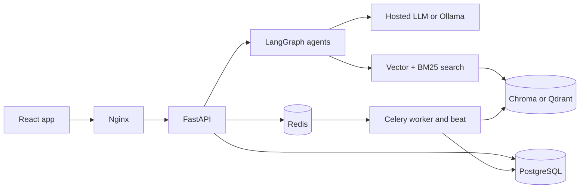

# CampusMind

An AI campus assistant. It answers questions from official college documents with citations, and acts through agents that plan study schedules, set reminders and summarize notes.

Built as a final-year B.Tech CSE project.

## Architecture



| Part | Technology |
|---|---|
| Backend | Python 3.11, FastAPI, Pydantic v2, SQLAlchemy 2, Alembic, PostgreSQL 16 |
| AI | LangGraph, sentence-transformers (bge-small-en-v1.5), ChromaDB or Qdrant, rank-bm25 |
| LLM | Anthropic API or Ollama, chosen by environment variable |
| Jobs | Celery and Redis |
| Frontend | React 18, TypeScript, Vite, Tailwind, React Query, Zustand |
| Operations | Docker, GitHub Actions, Prometheus, Grafana |

More detail: [architecture](docs/architecture.md), [database schema](docs/schema.md), [API contract](docs/api.md), [decisions](docs/decisions.md), and [design notes per module](docs/notes/).

## Setup

You need Docker, Node 22 and [Ollama](https://ollama.com) (or an Anthropic API key).

```bash
git clone <your repository> campusmind && cd campusmind
cp .env.example .env
ollama pull llama3.2:1b
docker compose -f infra/compose/docker-compose.dev.yml up -d --build
docker compose -f infra/compose/docker-compose.dev.yml exec -e SEED_PASSWORD=choose-a-password backend python scripts/seed.py
cd frontend && npm install && npm run dev
```

Open <http://localhost:5173> and log in as `student@college.edu`, `faculty@college.edu` or `admin@college.edu` with that password. The seed creates 20 invented documents for a fictional college.

`llama3.2:1b` is small enough for a laptop, but its answers are weak, and a long summary is impractical. Use a hosted model or a larger local one for real work.

### Without Docker

Only PostgreSQL needs replacing, for the tests and migrations. Redis is still required to run the workers.

```bash
cd backend
uv sync
uv run python scripts/devdb.py alembic upgrade head
uv run pytest -m "not model"
cd ../frontend && npm install && npm test
```

## Environment variables

Every variable is listed in [.env.example](.env.example). The ones that matter most:

| Variable | Purpose |
|---|---|
| `SECRET_KEY` | Signs tokens. Required in production, at least 32 characters |
| `DATABASE_URL`, `REDIS_URL` | Datastores |
| `LLM_PROVIDER` | `anthropic` or `ollama` |
| `LLM_MODEL` | Overrides the provider's default model |
| `ANTHROPIC_API_KEY` | For the hosted LLM |
| `LLM_MAX_CONCURRENCY` | Parallel summarizer calls. Use 1 with Ollama |
| `VECTOR_BACKEND` | `chroma` or `qdrant`. Use `qdrant` once an API and a worker run together |
| `CHUNK_SIZE_TOKENS`, `CHUNK_OVERLAP_TOKENS` | Chunking |
| `RERANK_ENABLED` | Adds the cross-encoder. Needs about 600 MB more memory |
| `ALLOWED_EMAIL_DOMAIN` | Who may register. Comma-separated |
| `SMTP_HOST` and related | Mail. If empty, messages are logged and not sent |
| `COOKIE_SECURE` | Must be `true` in production |
| `CONVERSATION_RETENTION_DAYS` | Older conversations are deleted. `0` keeps everything |

## Testing

| Command | Covers |
|---|---|
| `pytest -m "not model"` in `backend/` | Everything on real PostgreSQL, Chroma and Qdrant, with fake LLM, OCR and Redis |
| `pytest -m model` | The real embedding model. Downloads about 130 MB |
| `npm test` in `frontend/` | Chat, upload and the API client |

## What has and has not been run

| Part | State |
|---|---|
| Backend logic, migrations, permissions | Tested on real PostgreSQL 16 |
| Chroma, Qdrant, BM25, bge-small | Tested for real |
| Whole app in a real browser | Run with Playwright against real PostgreSQL, Chroma, bge-small and Ollama, as all three roles: 22 of 22 checks passed, including no sideways scroll at 360px |
| Clickable citation chips | Component tests only. `llama3.2:1b` never wrote a `[n]` marker in the browser runs |
| Long document summaries on `llama3.2:1b` | Run, and **not usable**: 47.5 minutes for 40 pages, and one bullet. See [the notes](docs/notes/summarizer.md) |
| Hosted LLM client | Tested against a stub only. It needs an API key to run for real |
| Real Redis, real Celery workers, SMTP | **Not run.** Tests use fakes and eager tasks |
| Tesseract OCR | **Not run.** It is not installed on the build machine. OCR tests use a stub |
| Re-ranker model | **Not run** |
| Docker images, compose files, Nginx, certificates, backups, Grafana, GitHub Actions | **Not run.** Docker was not available |
| Evaluation tools | The experiment grid has run end to end on the synthetic corpus, without the re-ranker |
| Evaluation numbers | **None yet.** Real documents are needed. See [eval/README.md](eval/README.md) |

## Deployment

See [docs/deploy-vm.md](docs/deploy-vm.md) for running on one cloud VM.

## Troubleshooting

| Symptom | Check |
|---|---|
| Nobody can log in after registering | SMTP is not set, so no verification mail arrives. Set `SMTP_HOST`, or see the logs in development |
| A document stays at `uploaded` | The Celery worker is not running, or cannot reach Redis |
| A document fails with "needs OCR" | Install Tesseract, or set `TESSERACT_CMD` |
| New documents do not appear in answers | With Chroma's local mode, the API and worker do not share data. Use `VECTOR_BACKEND=qdrant` |
| Every answer is a refusal | No document is `ready`, or `RAG_SIMILARITY_THRESHOLD` is too high for your embedding model |
| Answers time out with Ollama | Raise `LLM_TIMEOUT_SECONDS` and set `LLM_MAX_CONCURRENCY=1` |
| Signed out when two tabs are open | Two tabs refreshed at once, which looks like token theft. Log in again |
| Summaries say they were not fully checked | Some LLM calls failed. Read the worker logs |
| A login limit does not apply per user behind Nginx | Confirm `X-Forwarded-For` reaches uvicorn with `--proxy-headers` |

## License

Add a license before making this repository public.
