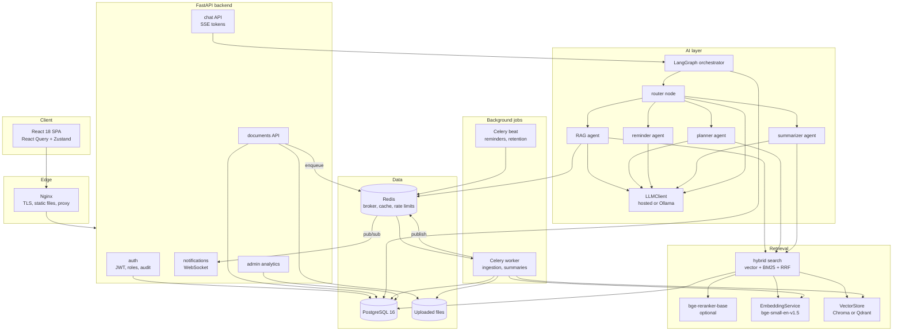

# CampusMind architecture

CampusMind answers questions from official college documents, with citations, and acts through specialised agents for study planning, reminders and summaries.

## System diagram



## Request flows

**Question.** The SPA opens an SSE stream to the chat API. The router classifies the message and sends `qa` intents to the RAG agent. That agent rewrites follow-ups, runs hybrid search with the student's department and semester as filters, builds a prompt capped at 6,000 tokens, and streams the LLM's tokens back. Citations arrive as the final event. Each node writes a row to `agent_traces`.

**Upload.** The API validates the file, stores it, inserts a `documents` row with status `uploaded`, and enqueues a Celery task. The worker extracts, cleans, chunks and embeds the file, updating `status` and `progress` as it goes. The chunk text goes to `chunks_meta` and the vectors go to the vector store.

**Reminder.** Celery beat scans for due `reminder_notifications` every minute. A unique idempotency key stops the same notification being claimed twice. The worker publishes to Redis, and the API process holding the user's WebSocket pushes it to the browser.

## Monorepo layout

```text
CampusMind/
├── backend/
│   ├── pyproject.toml
│   ├── alembic.ini
│   ├── alembic/versions/
│   ├── app/
│   │   ├── main.py            FastAPI app factory
│   │   ├── config.py          settings from environment variables
│   │   ├── logging.py         structured logging
│   │   ├── db.py              engine and session factory
│   │   ├── celery_app.py      Celery app and beat schedule
│   │   ├── models/            SQLAlchemy models
│   │   ├── api/               routers and dependencies
│   │   ├── auth/              login, tokens, roles
│   │   ├── ingestion/         extract, clean, chunk, tag, dedupe
│   │   ├── vectorstore/       stores, embeddings, hybrid search
│   │   ├── llm/               LLMClient interface and implementations
│   │   ├── rag/               question answering
│   │   ├── agents/            LangGraph graph and agents
│   │   ├── reminders/         scheduler and delivery
│   │   ├── conversations/     history and feedback
│   │   └── analytics/         admin metrics
│   └── tests/
│       └── fixtures/
├── frontend/                  React + Vite + Tailwind
│   ├── package.json
│   └── src/
│       ├── api/  components/  hooks/  pages/  stores/  test/
├── eval/                      test set, benchmarks, results
│   ├── retrieval_bench.py
│   ├── data/
│   └── results/
├── infra/
│   ├── docker/                Dockerfiles
│   ├── compose/               dev and prod compose files
│   ├── nginx/
│   ├── grafana/
│   └── scripts/               backups, seeding, VM setup
├── docs/
│   ├── architecture.md
│   ├── schema.md
│   ├── api.md
│   ├── decisions.md
│   └── notes/                 design notes per module
├── .github/workflows/
├── .env.example
└── README.md
```
