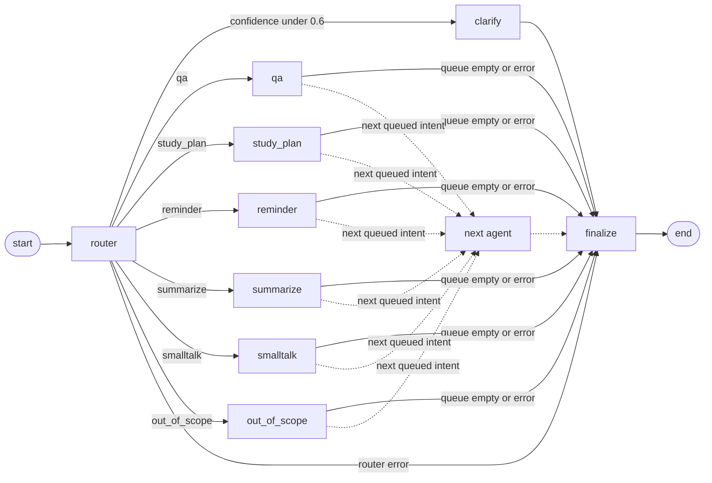

# Router and agent graph

Code: `backend/app/agents/`, `backend/app/api/admin.py`.

## The graph



The dotted path is the multi-step case. "Summarize unit 3 notes and make a plan to finish it by Friday" queues `summarize` then `study_plan`. The planner reads the summary from `tool_results`.

## How to test

```bash
pytest tests/test_agents.py
```

The 20 sample messages run against the keyword classifier. The LLM path is tested with scripted replies, including invalid ones.

`POST /conversations/{id}/messages` exposes the graph. Trace lookup is at `GET /api/v1/admin/traces/{trace_id}`.

## Key decisions

**1. The router returns an ordered list of intents, held in a queue.** The usual router returns one label, which cannot express "do A, then B". A queue in state keeps the graph simple: every agent has the same outgoing edge, "next in queue or finalize". *Rejected:* a planner agent that decides steps dynamically. That is more flexible, but each extra LLM decision adds cost and failure modes, and it is much harder to bound.

**2. Safety lives in one wrapper around every node.** Step limit, timeout, tracing and error handling are applied by `_wrap`, so a new agent cannot forget them. A failed step keeps the results of earlier steps and stops the queue. The user gets a friendly message with a reference id, and the real error goes to the logs and the trace row. *Rejected:* try/except in each agent.

**3. Agents are plain handler functions.** The graph knows nothing about planning or summarizing, and an agent knows nothing about LangGraph. Agents can be tested without a graph, and the graph can be tested with stub agents. Streaming works the same way: a handler calls `emit`, and the runner moves fragments across a queue.

## More design points

- **Keyword fallback.** Routing must not stop when the LLM does. An outage degrades to rules and keeps working.
- **Why confidence under 0.6 asks a question.** A wrong agent wastes more of the user's time than one clarifying question.
- **Why tools validate arguments.** Tool arguments come from an LLM, so they are untrusted input, like a request body.
- **Why smalltalk uses no LLM.** A greeting needs no model, so canned replies save cost and latency.
- **Step limit of 6.** Router plus finalize uses two, which leaves four agents. `MAX_INTENTS` is 4 so every accepted request fits.

## Known limits

- A timed-out node stops being waited for, but its thread keeps running until its LLM call times out, because Python cannot kill a thread.
- Router confidence comes from the model's own estimate, which is not calibrated.
- The keyword fallback only knows the patterns written into it.
